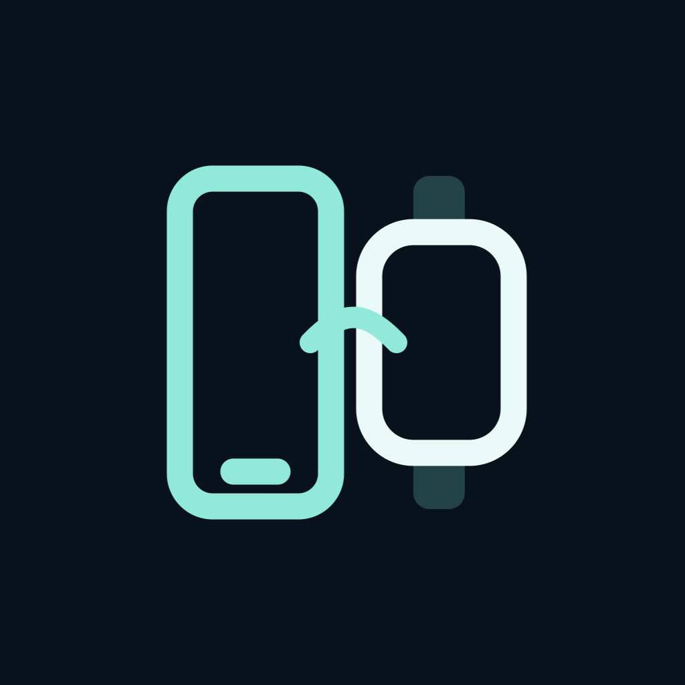

# FoldBridge Local

[한국어](README.md) · **English** · [Documentation / 문서](docs/README.md)

Forward notifications **directly from a Galaxy phone to Apple Watch over Bluetooth LE**. Notification delivery uses the two devices: no server, internet connection, iPhone relay, root access, or workout/audio session is needed.

Initial Apple Watch setup still requires a paired iPhone. Installing the watch app requires a Mac, Xcode, and your own Apple signing team. Background delivery depends on watchOS runtime availability; the optional location keepalive mode is experimental.



## Start here

**[Current release guide](docs/RELEASE_WATCH_v0.5.7_EN.md)**

| What you need | Download or guide |
| --- | --- |
| Android **0.6.3-local · code 19** | [Download APK](https://github.com/mhj604/FoldBridge/raw/refs/heads/local-ble/artifacts/android/FoldBridge-Local-0.6.3.apk) |
| Apple Watch **0.5.7 · build 31** | [Current source](https://github.com/mhj604/FoldBridge/archive/refs/heads/local-ble.zip) · [Xcode project](watch/FoldBridge.xcodeproj) |
| First installation | **[Step-by-step setup](docs/QUICK_START_EN.md)** |
| Common questions | [FAQ](docs/FAQ_EN.md) |
| Connection or notification problems | [Troubleshooting](docs/TROUBLESHOOTING_EN.md) |
| Latest downloads and changes | [Releases](https://github.com/mhj604/FoldBridge/releases) · [Archived 0.4.9 guide ZIP](https://github.com/mhj604/FoldBridge/releases/download/watch-v0.4.9/FoldBridge-0.4.9-guides-ko-en.zip) |

1. Install **FoldBridge Local** on the phone. Grant Nearby devices, notifications, and **notification access** for the relay service.
2. Open `watch/FoldBridge.xcodeproj` on your Mac. Select your Apple team, a unique Bundle ID, and your physical watch; press **Run**.
3. On the phone, open **Settings → Pair a new watch**. On the watch, open **Connect phone → Find phone** and select the Galaxy. Compare the codes and confirm on both devices.
4. Allow watch notifications. Optionally enable **Settings → Keep connection** and grant location permission.
5. Keep the phone's connection service running and both devices within Bluetooth range. Use **Refresh connection** on either device when needed.

Both `main` and [`local-ble`](https://github.com/mhj604/FoldBridge/tree/local-ble) contain the current source and Korean/English guides. The `relay/`, `windows/`, and `legacy/` folders preserve older designs and are not needed for Local operation.

```sh
git clone --branch local-ble https://github.com/mhj604/FoldBridge.git
cd FoldBridge
open watch/FoldBridge.xcodeproj
```


## MyHyundai through Galaxy

Android **0.6.3-local** / Watch **0.5.7** adds **FoldBridge watch → BLE → Galaxy official MyHyundai widget**. It does not redirect the original MyHyundai watch app. Bind the widget, choose controls on Galaxy, then open **Vehicle controls** in FoldBridge on the watch. A single **Vehicle controls widget** in Smart Stack or on a watch face opens the control panel. Choose Start engine / climate, Lock doors, Turn on hazard lights or Unlock doors inside the panel. Actual vehicle service requires internet and MyHyundai authentication; widget invocation is not vehicle success. **[Setup and scope](docs/VEHICLE_CONTROL_EN.md)** · [0.6.3 APK](artifacts/android/FoldBridge-Local-0.6.3.apk)

## Everyday use

- Forward app names, titles, bodies, and available source app icons over an encrypted BLE session. All apps are selected by default; you can choose individual apps.
- Read received notifications in **watchOS Notification Center**. The watch app keeps no separate message history.
- Unacknowledged notifications retry in memory only during the current connection. Disconnection clears this queue; notification payloads are not persisted on the phone.
- Every authenticated connection, including reconnections, starts with notifications posted after that connection completes. Earlier and offline notifications are not replayed.
- Samsung System UI charging updates are excluded by default. Enable charging notifications if you want them.
- **Refresh connection** preserves a healthy link and session while requesting synchronization. If disconnected, recovery uses the saved peer. **Sync now** retrieves pending notifications over an authenticated connection.
- Saved peers use Core Bluetooth's automatic reconnect request plus the app's retry path. If the devices leave Bluetooth range, the watch requests reconnection when the link drops and tries again when they return. Interference, power, and watchOS scheduling can still cause disconnects or delays; immediate recovery is not guaranteed.

### 한국어 / English

Each app has **Settings → Language / 언어 → System default / 한국어 / English**. The devices store their choices independently. System default uses Korean in a Korean environment and English otherwise. Received app names and message contents remain in their original language. Changing language preserves registration and pending notifications.

## What watch notifications look like

The initial system popup, Notification Center cards, and system header identify **FoldBridge** as the sending app. When a source icon is available, the **expanded notification body** shows it at **24pt**, alongside the original app name and message. Without an icon, the system text layout is used.

Source icons are not image attachments, so they do not become oversized media previews. The current build retains the compact expanded-body layout; Watch 0.4.7 kept the text/icon placement from 0.4.6 and reduced only the card's lower spacing by **4pt**. [Layout examples](docs/NOTIFICATION_LAYOUT_COMPARISON_EN.md) · [Display behavior and scope](docs/NOTIFICATION_DISPLAY_LIMITS_EN.md)

Android may redact sensitive notification content before the relay receives it. See [sensitive-content settings](docs/BUILD_AND_SETUP_EN.md#sensitive-notification-content) if you want full content on your own device. The APK does not grant itself this setting.

## Requirements and current scope

| Component | Requirement |
| --- | --- |
| Phone | Android 13+, BLE peripheral/advertising support, Nearby devices and notification access |
| Watch | Build target: watchOS 10+. Current physical-device observations: Ultra 2 / watchOS 27.0.1 |
| Watch installation | Mac with compatible full Xcode, developer mode, development pairing, your Apple signing team |
| Apple account | Free Personal Team supported; it need not match the watch's account |

The current release clears old notifications on every reconnection, restarts phone advertising after disconnect, and retains background recovery requests. Recovery still depends on Bluetooth range and watchOS scheduling. [Release details](docs/RELEASE_WATCH_v0.4.9_EN.md)

watchOS suspension, force-quit, runtime budgets, Bluetooth range, Focus, and notification permission affect delivery. Location keepalive can increase battery use. Development signing may expire and require rebuilding. Replies and bidirectional read/delete synchronization are not implemented. Notification text, private keys, device logs, and location coordinates are not published in this repository; location coordinates are not retained or transmitted by keepalive.


The free account's seven-day signing can be refreshed by a scheduled Mac task. See [automatic renewal and connection requirements](docs/AUTO_RENEW_EN.md).

## Build or contribute

- [Build, signing, and device settings](docs/BUILD_AND_SETUP_EN.md)
- [Architecture](docs/ARCHITECTURE_EN.md) · [BLE protocol](docs/PROTOCOL_EN.md)
- [Changelog](CHANGELOG.en.md) · [Development history](docs/DEVELOPMENT_HISTORY_EN.md)
- [Contributing](CONTRIBUTING.en.md) · [All documentation](docs/README.md)

The Android APK is available in Releases and `artifacts/android/`. To update an existing installation, keep the same Android signing key or the same watch Bundle ID and team. A self-built APK with a different key cannot update the distributed APK in place. [Updating without losing registration](docs/QUICK_START_EN.md#updating)
