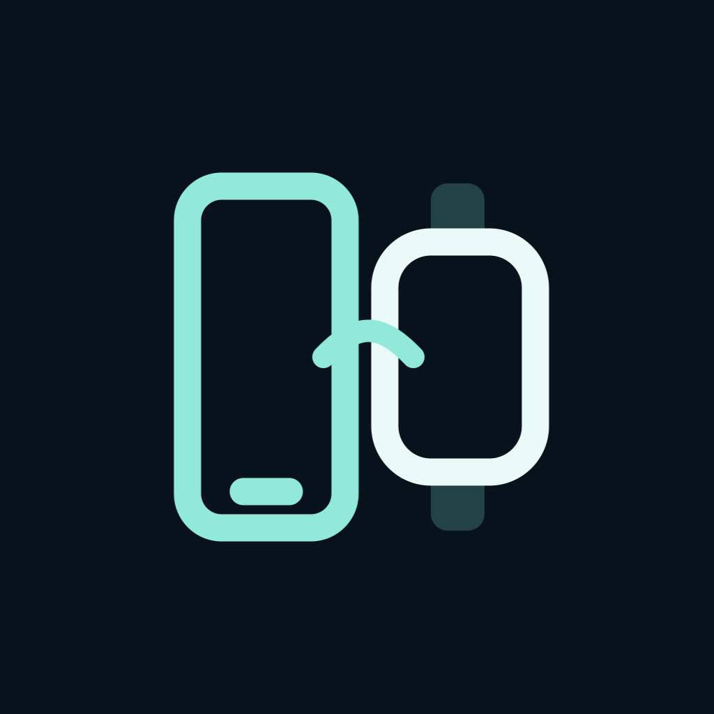

# FoldBridge Local

갤럭시에 도착한 알림을 **Apple Watch로 직접 전달**하는 Android·watchOS 앱입니다. 두 기기는 Bluetooth LE로 통신하며, 알림 전달에 서버·인터넷·페어링된 아이폰을 사용하지 않습니다. 루팅·운동·오디오 세션도 사용하지 않습니다.

워치의 최초 설정과 개발용 앱 설치에는 Apple의 기기 등록과 Mac/Xcode가 필요합니다. 위치 세션을 이용하는 백그라운드 수신은 실험 기능이며, watchOS가 앱을 중단할 수 있어 모든 알림의 상시·즉시 수신을 보장하지는 않습니다.



## 바로 시작하기

| 항목 | 현재 버전 / 링크 |
| --- | --- |
| 사용·수정용 브랜치 | [`local-ble`](https://github.com/mhj604/FoldBridge/tree/local-ble) — 서버 없는 BLE 구성 |
| Android | **0.5.0-local · 코드 10** / [APK 다운로드](artifacts/android/FoldBridge-Local-0.5.0.apk) |
| Apple Watch | **0.4.2 · 빌드 13** / [Xcode 프로젝트](watch/FoldBridge.xcodeproj) |
| 배포 묶음 | [GitHub Releases](https://github.com/mhj604/FoldBridge/releases) |
| 처음 설치하는 경우 | **[처음부터 설치하고 연결하기](docs/QUICK_START_KO.md)** |
| 연결이 끊긴 경우 | **[새로고침·문제 해결](docs/TROUBLESHOOTING_KO.md)** |

1. 갤럭시에 APK를 설치하고 **근처 기기·알림·알림 접근**을 허용합니다.
2. Mac에서 소스를 받아 `watch/FoldBridge.xcodeproj`를 Xcode로 엽니다. 자신의 Team과 고유한 Bundle ID를 선택해 실제 워치에 설치합니다. 다른 사람의 워치 서명 파일을 그대로 설치하는 방식은 아닙니다.
3. 갤럭시 **설정 → 새 워치 등록**, 워치 **휴대폰 연결 → 휴대폰 찾기**에서 서로 선택합니다. 코드가 같으면 양쪽에서 확인합니다.
4. 워치에서 알림 표시를 허용합니다. 원하는 경우 **설정 → 연결 유지**를 켜고 위치 권한을 허용합니다.
5. 연결이 풀리면 **갤럭시와 워치의 ‘연결 새로고침’**을 누릅니다. 기존 등록과 대기 알림은 보존됩니다.

```sh
git clone --branch local-ble https://github.com/mhj604/FoldBridge.git
cd FoldBridge
open watch/FoldBridge.xcodeproj
```

`main`에도 최신 소스와 한국어 문서를 반영합니다. `relay/`, `windows/`, `legacy/`는 과거 구성으로 현재 Local 앱 실행에는 필요하지 않습니다.

## 한국어 / English 전환

갤럭시와 워치 앱의 **설정 → 언어 / Language**에서 **시스템 설정·한국어·English**를 선택합니다. 각 기기에서 따로 선택하며, 재실행과 재시작 후에도 유지됩니다. 시스템 설정을 선택하면 한국어 환경은 한국어, 그 외 환경은 영어를 사용합니다.

버튼·설정·연결 상태·오류 안내·진단과 앱 자체 연결 알림을 번역합니다. 다른 앱에서 전달받은 알림 제목·본문·앱 이름은 원문 그대로 유지합니다. 언어를 변경해도 등록 키와 미전달 알림을 지우지 않습니다. OS가 표시하는 권한 창은 해당 기기의 시스템 언어 설정을 따를 수 있습니다.

## 무엇을 할 수 있나요?

- 다른 앱의 제목·본문·원본 앱 아이콘을 암호화해 워치로 전달합니다. 모든 앱 전달이 기본이며 앱 선택도 가능합니다.
- 알림은 워치 **알림 센터**에 표시합니다. FoldBridge 내부에 이전 메시지 목록이나 본문을 따로 보관하지 않습니다.
- 미전달 알림만 휴대폰에 암호화해 최대 24시간·1,024개 대기시킵니다. 워치가 표시 요청을 수락하면 대기열에서 제거합니다.
- 충전율 변경 때 반복되던 Samsung System UI 충전 알림은 기본 제외합니다. **충전 상태 알림**을 켜면 포함합니다.
- 재부팅 후 저장된 등록으로 재연결을 시도합니다. 양쪽 첫 잠금 해제와 Bluetooth가 필요합니다. 워치가 자동 실행되지 않으면 FoldBridge를 한 번 열어 주세요.
- **연결 새로고침**은 기존 등록 키를 유지한 채 낡은 연결·인증 상태를 정리하고 다시 연결합니다. **지금 동기화**는 이미 연결된 상태에서 미전달 알림을 가져옵니다.

## 알림 모양과 개인정보 표시

알림 센터의 카드와 눌러서 펼친 상세 화면을 모두 **watchOS 기본 알림 화면**으로 표시합니다. 현재 기본 레이아웃에서는 원본 앱 아이콘을 별도로 표시하지 않으며, 앱 이름·제목·본문으로 구분합니다. 앱 아이콘을 사진 첨부로 보내지 않습니다. 이미지 첨부는 watchOS에서 큰 미디어 미리보기와 카드 썸네일로 재사용되므로 앱 아이콘 대체 방식으로 사용하지 않습니다. 글꼴·줄바꿈·여백·스크롤은 시스템이 처리합니다. 처음 뜨는 아이콘과 상단 앱 이름은 watchOS가 FoldBridge로 생성합니다. [Apple 알림 표시 구조](https://developer.apple.com/documentation/watchos-apps/presenting-notifications-on-apple-watch)

Android가 민감한 본문을 가리면 워치에도 가림 문구가 전달됩니다. 본문 전체 전달을 원하는 사용자는 자신의 기기에서 앱별 수신 설정을 할 수 있습니다. **[민감한 알림 본문 허용](docs/BUILD_AND_SETUP.md#민감한-알림-본문-허용)**을 참고하세요. APK가 이 설정을 스스로 부여하지 않습니다.

알림 내용·개인 키·위치 좌표를 진단 파일이나 이 저장소에 올리지 않습니다. 위치 연결 유지에서도 좌표는 저장하거나 전송하지 않습니다.

## 환경과 한계

| 환경 | 필요 사항 |
| --- | --- |
| 갤럭시 / Android | Android 13 이상, BLE peripheral/광고 지원, 근처 기기와 알림 접근 허용 |
| Apple Watch | watchOS 10 이상 대상으로 빌드, Bluetooth와 알림 권한. 실제 사용 기기는 Ultra 2 / watchOS 27 계열 |
| 워치 앱 설치 | Mac, 기기 OS에 맞는 Xcode, 자신의 Apple 개발 Team, 개발자 모드와 Mac 개발용 페어링 |
| Apple 계정 | 무료 Personal Team 사용 가능. 갤럭시와 워치 계정을 맞출 필요는 없습니다. 워치 설치 서명은 자신의 Team을 사용합니다. |

워치 개발용 서명은 만료에 따라 재서명이 필요할 수 있습니다. 위치 세션은 배터리를 더 사용하며, 강제 종료·OS의 실행 예산·Bluetooth 범위·집중 모드·알림 권한은 수신에 영향을 줍니다. 읽음/삭제의 양방향 동기화와 답장은 구현하지 않았습니다.

## 직접 빌드하거나 기여하기

- [설치·연결 순서](docs/QUICK_START_KO.md)
- [빌드 도구·서명·민감한 알림 설정](docs/BUILD_AND_SETUP.md)
- [문제 해결과 새로고침 사용법](docs/TROUBLESHOOTING_KO.md)
- [구조](docs/ARCHITECTURE.md) / [BLE 프로토콜](docs/PROTOCOL.md)
- [변경 이력](CHANGELOG.md) / [전체 구축 이력](docs/DEVELOPMENT_HISTORY.md)
- [기여 방법](CONTRIBUTING.md)

Android APK는 저장소와 Releases에서 내려받을 수 있습니다. Apple 서명 프로파일·Android 서명 키·기기 로그는 공개하지 않습니다. 자기 키로 빌드한 Android 앱은 배포 APK와 서명이 달라 같은 앱 위에 업데이트할 수 없습니다. **[서명과 업데이트 안내](docs/QUICK_START_KO.md#업데이트할-때)**를 먼저 읽어 주세요.
