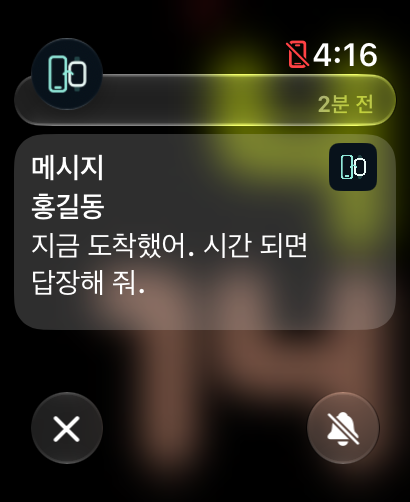
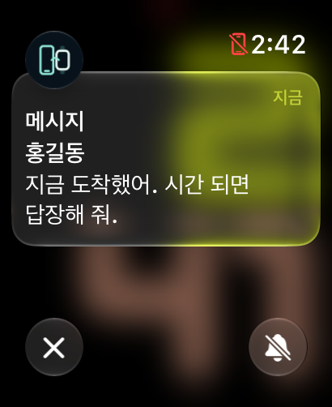
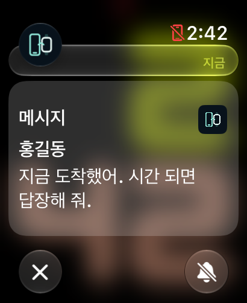
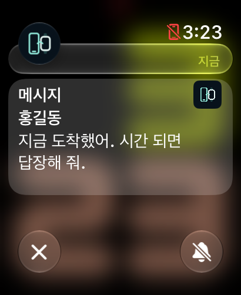
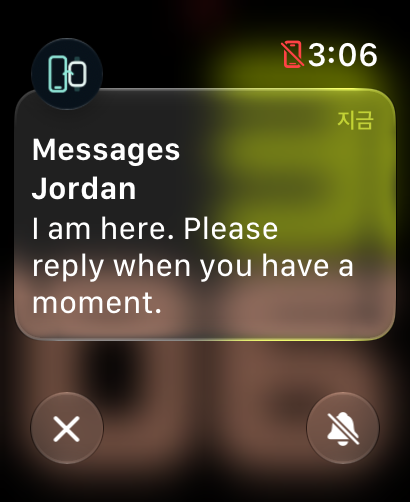
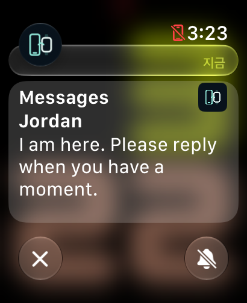

# Notification layout examples and history

[한국어](NOTIFICATION_LAYOUT_COMPARISON_KO.md) · **English** · [All guides](README.md)

These are existing example captures from 2026-10-31, not personal messages. The comparison uses an Ultra 2-sized watchOS 27.2 simulator, 205×251pt / 410×502px. A generic icon occupies the source-icon position.

## Current Watch 0.4.7

The 24pt source icon and title/sender/body positions from 0.4.6 are retained. Only lower layout spacing is reduced by **4pt** on watchOS 27+. There is no fixed body height; long notifications use system scrolling. The same Korean example has text-row starts at **155/194/233/270px** in both 0.4.6 and 0.4.7, with 25px glyph height. These describe that example, not fixed coordinates for every device/font.

## How the placement evolved

| System text layout | Watch 0.4.4 | Watch 0.4.5 |
| --- | --- | --- |
|  |  |  |

Existing PNG measurements of white text glyphs, in pixels (2px = 1pt):

| Measurement | System | 0.4.4 | 0.4.5 |
| --- | ---: | ---: | ---: |
| Title start y | 137 | 182 | 149 |
| Sender start y | 176 | 233 | 188 |
| First body row y | 215 | 279 | 227 |
| Second body row y | 252 | 319 | 264 |
| Title glyph height | 25 | Larger 17pt base font | 25 |
| Title glyph width | 69 | 73 | 69 |
| Body row distance | 37 | 40 | 37 |
| Title left x | 33 | 33 | 33 |

Watch 0.4.5 matched the example's text size, left baseline, and row spacing more closely, with the body still 6pt lower. Watch 0.4.6 then moved text and icon together **3pt downward** following user feedback; the same row starts became 155/194/233/270px. Watch 0.4.7 retains that placement and trims the bottom spacing.

## English example from the earlier comparison

| System text layout | Watch 0.4.5 |
| --- | --- |
|  |  |

Glyph size/baselines became closer, but line wrapping can differ between system and SwiftUI text. Narrowing the body to match one English example caused earlier wrapping in Korean paragraphs, so body width was retained.

## Implementation scope

- Base 16pt system font scales with `ScaledMetric`; title and sender are semibold.
- The left baseline is 16pt; Ultra 2 body width is 173pt. The title reserves room for the 24pt icon overlay.
- Extra paragraph gap is zero. Body line height is based on 18.5pt on watchOS 26+, with the system default on older OS versions.
- Icon measurement is separate from text rows, with minimum space retained for short notifications.
- The watchOS 27 top correction evolved from −16pt in 0.4.5 to −13pt in 0.4.6/0.4.7; the current lower correction is −4pt.

Earlier observations included Korean/English, title-only content, long text, and emoji. The simulator did not support the attempted CLI text-size change. Identical placement across other watch sizes/OS versions was not established. System short-look, cards, and expanded headers remain watchOS-owned; this body layout does not replace their templates.
