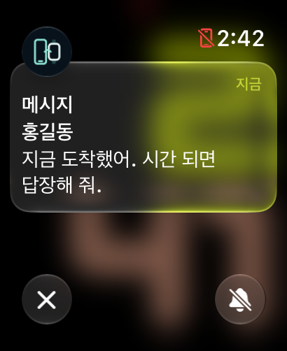
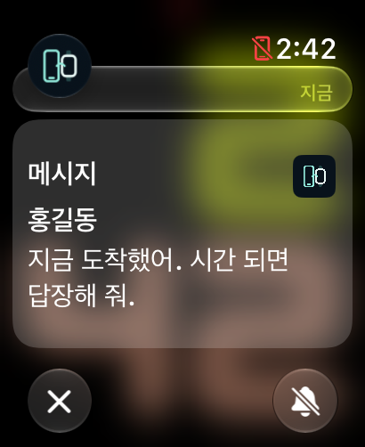
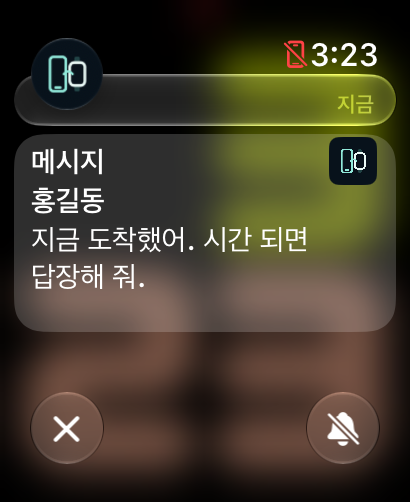
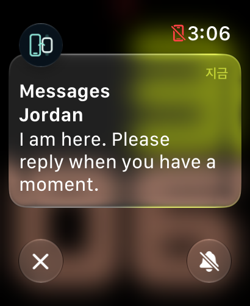
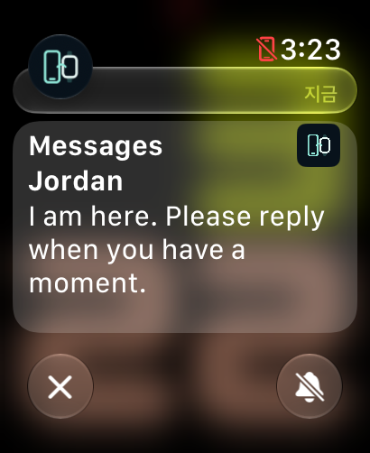
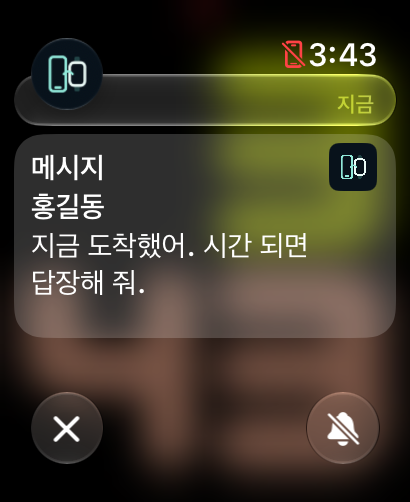

# Watch 0.4.5 알림 레이아웃 비교

2026-10-31, Apple Watch Ultra 2 크기(205×251pt / 410×502px), watchOS 27.2 시뮬레이터에서 동일 내용의 시스템 기본 알림과 사용자 정의 상세 알림을 비교했습니다. 실제 개인 메시지가 아닌 예문이며, 오른쪽 원본 아이콘 자리에는 비교용 아이콘을 사용했습니다.

## 한국어 비교

| 기본 텍스트 알림 | 이전 0.4.4 | 변경 0.4.5 |
| --- | --- | --- |
|  |  |  |

흰 글자 픽셀의 시작점을 원본 PNG에서 측정했습니다. 단위는 px입니다. 2px=1pt이며, 글리프의 위치를 측정한 값이지 Apple이 공개한 레이아웃 치수는 아닙니다.

| 항목 | 기본 | 0.4.4 | 0.4.5 |
| --- | ---: | ---: | ---: |
| 제목 시작 y | 137 | 182 | 149 |
| 발신자 시작 y | 176 | 233 | 188 |
| 본문 첫 줄 시작 y | 215 | 279 | 227 |
| 본문 둘째 줄 시작 y | 252 | 319 | 264 |
| 제목 글리프 높이 | 25 | 더 큰 17pt 글꼴 | 25 |
| 제목 글리프 폭 | 69 | 73 | 69 |
| 본문 줄 간격 | 37 | 40 | 37 |
| 제목 왼쪽 x | 33 | 33 | 33 |

0.4.5에서는 비교한 한국어 글자의 크기·왼쪽 기준선·각 줄 사이 거리가 일치합니다. 전체 본문은 12px(6pt) 아래에 남습니다. 더 큰 상단 보정은 작은 원본 아이콘을 잘라내므로 채택하지 않았습니다.

## 영어 비교

| 기본 텍스트 알림 | 변경 0.4.5 |
| --- | --- |
|  |  |

영어 예문은 글리프 크기와 기준선이 가까워졌지만 줄바꿈은 다릅니다. 영어 예문 하나의 줄바꿈을 맞추기 위해 본문을 10pt 좁혀 보기도 했으나 한국어 여러 문단에서 더 일찍 줄바꿈돼 채택하지 않았습니다. 최종안은 본문 폭을 유지합니다. 시스템 기본 화면과 SwiftUI 텍스트의 문장별 줄바꿈 차이는 남습니다.

## 구현과 범위

- 기본 16pt 시스템 글꼴을 `ScaledMetric`으로 확대·축소합니다. 제목과 발신자는 semibold입니다.
- 텍스트 왼쪽 기준선은 16pt, Ultra 2의 본문 폭은 173pt입니다. 제목은 오른쪽 24pt 아이콘과 겹치지 않도록 더 좁게 배치합니다.
- 추가 문단 간격은 0pt입니다. watchOS 26 이상에서는 본문 줄 높이를 기본 18.5pt로 맞춥니다. 이전 OS는 시스템 줄 높이를 사용합니다.
- 원본 아이콘은 행 높이 계산에서 분리하고, 내용이 짧아도 아이콘을 위한 최소 높이는 보존합니다.
- watchOS 27에서만 상단을 16pt 보정합니다. 이전 OS의 컨테이너에는 이 보정을 적용하지 않습니다.
- 한국어·영어, 본문 없는 알림, 긴 본문, 이모지에서 표시를 살폈습니다. 시뮬레이터 CLI의 글자 크기 변경은 런타임 미지원으로 비교하지 못했습니다. 다른 워치 크기·OS의 동일 배치는 아직 확인하지 않았습니다.

watchOS는 사용자 정의 상세 알림의 시스템 상단 바와 본문을 분리해 그립니다. 앱 본문을 조정해도 기본 알림의 통합 카드 구조로 바꾸지는 못합니다. 이번 변경은 작은 원본 앱 아이콘을 유지하면서 글씨 배치를 가깝게 맞추는 범위입니다. 사진 첨부·비공개 시스템 API는 사용하지 않습니다.

## 0.4.6 · 아이콘과 글씨를 3pt 아래로 조정

사용자 피드백에 따라 작은 원본 아이콘과 본문 전체를 0.4.5보다 **3pt 아래로** 옮겼습니다. 글자·아이콘 크기와 문단·줄 간격은 바꾸지 않았습니다. 동일 예문의 글리프 시작 y는 149/188/227/264px에서 155/194/233/270px로 각각 6px(3pt) 내려갔습니다. 위 표와 이미지는 0.4.5 당시의 비교 기록으로 남깁니다.

